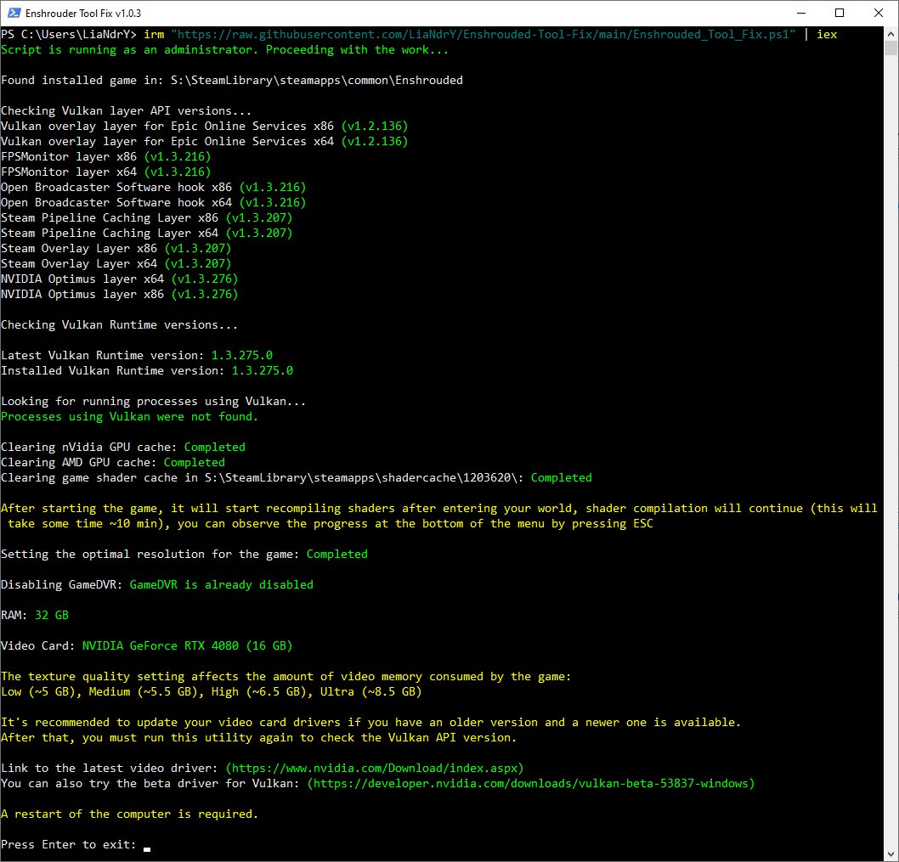

# Enshrouded-Tool-Fix: Diagnostics & Repair Utility for Windows 11

    

---

Enshrouded-Tool-Fix is a diagnostic and remediation utility for Enshrouded that inspects system configuration and applies targeted fixes for common Vulkan-related issues. It validates the Vulkan graphics API, checks video driver versions and shader caches, verifies paging file and RAM parameters, and reviews system settings such as game mode and power schemes. The tool can clear DirectX and Vulkan caches, adjust configuration values in the game's local JSON settings, and generate a log file on completion. It runs standalone and should be launched while Enshrouded is closed.

## Features

- **Vulkan diagnostics and repair:** Scans the system for common Vulkan graphics API misconfigurations affecting Enshrouded and applies corrective actions, including detection of the installed Vulkan Runtime layer version and forced installation of a healthy runtime state.

- **GPU vendor-specific handling:** Detects the installed video card brand and adapts its logic per vendor. Provides dedicated handling for NVIDIA, AMD, and Intel graphics adapters, including correct identification of Vulkan layer versions, clearing vendor-specific shader caches, and unlocking of Vulkan Runtime files where updates would otherwise fail.

- **Shader and pipeline cache cleanup:** Purges stale Vulkan shader caches from user profile locations and performs optional DirectX cache clearing to resolve corruption and launch failures.

- **System requirement checks:** Verifies CPU capabilities, including AVX instruction support and Intel processor stability checks, and validates system memory and paging file configuration against recommended thresholds.

- **Game configuration corrections:** Searches for the installed Enshrouded location and its local JSON settings files, repairs and resaves them in a compatible format, adjusts parameters such as background sleep behavior, and applies a minimal field-of-view value known to mitigate certain crashes. Reports the path to any problematic JSON file it encounters.

- **Launch environment tuning:** Forces the game process into normal priority on startup, sets a high-performance power scheme when a lower tier is active, enables or disables GameDVR, and applies network responsiveness optimizations.

- **Hardware detection and reporting:** Enumerates installed graphics hardware, determines native monitor resolution, calculates available video memory, and displays the video driver version and date alongside the hostname.

- **Logging:** Produces a log file at the end of each run for troubleshooting and verification of applied changes.

## How It Works

The utility operates as a diagnostic and remediation layer that sits between the game and the underlying system configuration. Rather than modifying game binaries, it inspects the environment in which Enshrouded runs and adjusts the settings and runtime components that most commonly contribute to launch failures, crashes, and rendering instability.

At its core, the tool performs a structured scan of the host system. It identifies installed graphics hardware across vendors, enumerates the active Vulkan layers and runtime components, and determines their versions and integrity. Where discrepancies or stale components are detected, the utility reconciles them by unlocking and refreshing the affected runtime files so that updates can be applied cleanly. This includes targeted handling of Vulkan shader caches stored in user-level application data directories, which are cleared to eliminate corrupted or outdated compiled shaders.

Beyond graphics-layer inspection, the utility evaluates several system-level conditions that influence game stability. It checks processor capabilities, including instruction-set support, and verifies the configuration of the paging file. Memory availability is assessed, and the active power scheme is adjusted toward a high-performance profile when a balanced or power-saving plan is detected. System responsiveness and network throughput parameters are also tuned as part of the same pass.

Configuration files belonging to the game are parsed and, where necessary, corrected. The utility normalizes JSON settings, adjusts parameters such as background sleep behavior, and can constrain field-of-view values to a conservative minimum as a mitigation for crash scenarios. It also resolves the game's installation path even when custom launch parameters are defined, ensuring that subsequent operations target the correct directory.

For systems where a dedicated gaming mode, GameDVR, or similar capture and scheduling features are present, the utility toggles these components to reduce interference during gameplay. Process priority for the game is enforced at a normal level on launch to avoid contention with background services.

The tool records its activity in a log file generated at the end of each run, providing a trace of checks performed and changes applied. Diagnostic output, including the host machine name, driver version and date, and the location of any problematic configuration file, is surfaced to the user so that results can be reviewed and verified.

All operations are executed against the local system only, and the utility is intended to be run while the game is not active so that no file locks or runtime state interfere with the applied changes.

## Requirements

- Windows 10 or Windows 11 (64-bit) operating system.
- PowerShell 5.1 or later, with the ability to run the utility with administrator privileges when required.
- The game Enshrouded must be installed and detected on the target system.
- The utility should be launched only while the game is closed.
- A system configuration with a supported GPU (NVIDIA, AMD, or Intel) is recommended for accurate diagnostics and fixes.
- Sufficient free disk space for log file creation and temporary diagnostic data.
- Network access may be required for certain checks and updates performed by the utility.
- No external dependencies or additional runtime installations are necessary; the utility runs as a standalone script.
- The utility is designed to work across a range of system configurations, though results may vary depending on hardware and software environment.

## Changelog

#### v1.1.14

- Launch Fix

#### v1.1.13

- Added support for Enshrouded v1.0+
- Added check for Intel processors (Vmin Shift Instability)
- Refactored code

#### v1.1.12

- Added display of computer name (hostname)

#### v1.1.11

- The algorithm for determining the latest version of VulkanRT on the developer's website has been fixed
- Added check for disabled system gaming mode

#### v1.1.10

- Fixed the algorithm for determining the version of the Vulkan layer due to the update of the format of new video card drivers
- Added display of the version and date of the video card driver

#### v1.1.9

- Fixed the algorithm for determining the latest available version of Vulkan RT

#### v1.1.8

- Fixed the algorithm for detecting Vulkan layers in the system due to the update of drivers for video cards
- Fixed the algorithm for clearing the cache for video cards from Intel
- Added forced installation of the 'Normal' priority when starting the game
- Added cache clearing for DirectX (just in case)

#### v1.1.7

- Added cleaning of Vulkan shader cache from LocalAppData folder

#### v1.1.6

- Improved algorithm for detecting Intel graphics cards

#### v1.1.5

- Added additional output of the path to the problematic JSON file to the screen if one is encountered

#### v1.1.4

- Fixed an issue with nVidia video cards where, after installing a new video driver, the script could not determine the version of the Vulkan layer

#### v1.1.3

- Improved algorithm for calculating video memory for all brands of video cards

#### v1.1.2

- Added support for Intel video cards

#### v1.1.1

- Added text explanation if the script does not find the installed game
- Fixed detection of AMD video cards

#### v1.1.0

- Added creation of a log file at the end of the script

#### v1.0.14

- Improved paging file checking system
- Added checking for AVX instructions on the CPU

#### v1.0.13

- Added checking the parameters of the paging file

#### v1.0.12

- Minor fixes

#### v1.0.11

- Added unlocking of Vulkan Runtime files in the system of AMD video card users for successful update

#### v1.0.10

- Fixed the logic for searching for a video card in the system

#### v1.0.9

- Fixed version definition and API name of the Vulkan layer; if they are empty, the version will be determined as 0.0.000 and the layer will be deleted

#### v1.0.8

- Fixed a problem when running the script through PowerShell versions higher than version 5, it broke the formatting of the json settings file

#### v1.0.7

- Fixed saving json settings files
- Added changing the "sleepInBackground" parameter to false in the enshrouded_local.json file
- Added increase of system responsiveness and network throughput
- Added setting of the "High Performance" energy saving scheme if "Balanced" or "Power saver" is installed
- Minor logic fixes

#### v1.0.6

- Added setting FOV to a minimum value (may help with game crashes)

#### v1.0.5

- Added a correct search for the path to the game if the launch parameters are specified in Steam

#### v1.0.4

- Changed some value search algorithms
- Added on/off GameDVR
- Changed the logic for searching for the native resolution for the main monitor

#### v1.0.3

- Added check RAM

#### v1.0.2

- First release

## Disclaimer

This utility is provided as a diagnostic and remediation aid for systems experiencing issues with Enshrouded. It performs a series of checks and applies targeted configuration adjustments, including Vulkan runtime and layer verification, shader cache clearing for Vulkan and DirectX, page file parameter validation, AVX instruction detection, power scheme enforcement, GameDVR toggling, and game-specific JSON settings modifications. The tool is designed to operate against a closed game instance and produces a log file upon completion to document its actions and findings.

Results are system-dependent and not guaranteed. The utility was developed and validated primarily against a specific hardware and driver configuration, and behavior on other configurations may differ. No warranty is expressed or implied regarding its effectiveness, completeness, or suitability for any particular system. Users assume full responsibility for any changes applied to their environment and are advised to review the generated log file to understand what modifications were performed.

## License

This project is distributed under the MIT License, a permissive open-source license that grants broad rights to use, copy, modify, merge, publish, distribute, sublicense, and sell copies of the software. The full license text is provided in the LICENSE file at the root of the repository and should be reviewed before any redistribution or derivative work is created.

The software is provided "as is", without warranty of any kind, express or implied, including but not limited to the warranties of merchantability, fitness for a particular purpose, and noninfringement. In no event shall the authors or copyright holders be liable for any claim, damages, or other liability, whether in an action of contract, tort, or otherwise, arising from, out of, or in connection with the software or the use or other dealings in the software.

Redistribution in source or binary form is permitted provided that the original copyright notice and this permission notice are retained in all copies or substantial portions of the software. Modified versions must be clearly identified as such, and any distribution of derivative works should preserve attribution to the original project.

Because this utility modifies system-level configuration related to graphics drivers, Vulkan runtime components, shader caches, and game settings, downstream users and integrators are expected to validate behavior in their own environments. The license does not extend any warranty to system changes performed by the tool; responsibility for testing, deployment, and rollback procedures rests with the party distributing or executing the software.

Contributions submitted to the project are accepted under the same license terms unless explicitly stated otherwise, ensuring that the project remains consistently licensed for all users and downstream consumers.

